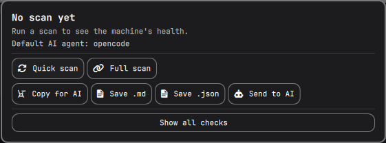

# System Diagnostics

A bar widget for [Omarchy](https://omarchy.org) that runs a **read-only** health
scan of the machine, shows a traffic-light verdict in the bar, and produces a
report written to be pasted into — or sent straight to — an AI assistant.



Every finding is based on local command output or system data. The scanner does
not change system configuration, install packages, restart services, or perform
repairs. It does create its private state directory and update a cached scan in
`~/.local/state/system-diagnostics/`.

## Features

- **Traffic-light bar indicator** — green when all checks pass, amber when
  something needs attention, red when there is a real problem. "Could not check"
  is shown amber, never green: an unrun probe is not a pass.
- **Quick scan** — local only, a few seconds (system, Omarchy, systemd, journal,
  storage, packages, security).
- **Full scan** — adds the slower probes (network reachability and DNS, GPU
  drivers and Vulkan, SMART disk health, package updates, `pacman -Qkk`).
- **AI-ready output** — a prompt states the verdict, lists every finding with
  its evidence, and asks for diagnosis and remediation guidance. Copy it, save
  it as Markdown/JSON, or send the complete report to your default AI agent
  after a confirmation step (see below).
- **Open, inspectable checks** — every finding carries an id, a value, a plain
  explanation and a suggested action. Nothing is a black box.

## Detecting your AI agent

The plugin does **not** hardcode an assistant. To send a report it asks Omarchy
which agent you chose:

```sh
omarchy default agent            # prints e.g. opencode, claude, codex, gemini…
```

The answer is read **per user**, from the downloader's own Omarchy configuration,
so the plugin always opens *their* agent — not the author's. Because it goes
through the CLI, the plugin carries no list of agents and works for any agent
Omarchy supports (`opencode`, `claude`, `codex`, `gemini`, `grok`, `copilot`,
`crush`, `cursor-agent`, `muse`, `pi`, `omp`, `hermes`, `openclaw`) without a
code change. Detection is re-run every time the panel opens, and the `omarchy`
binary is resolved from a short candidate list so a repackaged Omarchy cannot
break it on another machine.

That slug is shown in the panel (`Default AI agent: claude`); the action button
is labeled **Send to AI**. If a default is set, the panel explains what the
report may contain and asks for confirmation. It then launches the agent through
`omarchy agent prompt`, passing the complete report as the prompt (not merely a
file path), and opens it in a terminal window. The instructions ask the agent
to analyze evidence and recommend steps, not to run commands or change the
machine.

If **no** default agent is set, nothing is launched silently: the ready-to-paste
prompt is put on your clipboard and the panel tells you how to choose one:

```sh
omarchy default agent opencode  # or claude, codex, gemini, …
```

Nothing is sent until you click **Send to AI** and then confirm. Reports can
include your hostname, local paths, network details, and excerpts from system
logs. Review the report before confirming if that information is sensitive.
The plugin saves the outgoing prompt locally as well.
Omarchy may launch the selected agent with its configured non-interactive
permissions. The prompt requests analysis only, but the plugin cannot enforce
that instruction; supervise the agent's terminal session.

## Install

```sh
omarchy plugin add https://github.com/angelherman0130-cell/omarchy-system-diagnostics.git --enable
```

Or copy this folder to `~/.config/omarchy/plugins/angelherman.system-diagnostics`
and enable it:

```sh
omarchy plugin enable angelherman.system-diagnostics
```

Then click the widget in the bar.

## Remove

Disable the widget, then remove the installed plugin:

```sh
omarchy plugin disable angelherman.system-diagnostics
omarchy plugin remove angelherman.system-diagnostics
```

This does not delete scan reports already saved under
`~/.local/state/system-diagnostics/`; remove those separately if you no longer
want to keep them.

## Usage

| Action | Result |
| --- | --- |
| Left click the bar widget | Open the panel |
| Right click | Quick scan |
| Middle click | Full scan |
| `R` / `F` in the panel | Quick / Full scan |
| `A` | Copy the AI prompt |
| `S` | Save the Markdown report |
| `D` | Show all checks, not just findings |
| `Q` / `Esc` | Close |

Reports are saved under `~/.local/state/system-diagnostics/`.

## Privacy

System probes are read-only. The plugin never repairs, restarts, enables or
deletes anything; findings carry a *suggested* action, never an executed one.
The scan runs with a hardened `PATH=/usr/bin:/bin` and a minimal environment.
The only feature that may send report content outside the machine is the
explicitly confirmed AI action. Whether the AI service is local or remote
depends on the selected agent and its configuration.

## Requirements

Omarchy (with `omarchy-shell`). The plugin has no third-party runtime package
dependencies of its own. Its read-only probes use Omarchy/Arch system tools;
optional tools include `jq`, `wl-clipboard`, `smartctl`, `vulkaninfo`, `btrfs`,
`ufw`/`nftables` and others. Missing tools or unavailable permissions can make
individual checks report **unknown**. Sending to an AI also requires a
configured, installed default agent; that agent may have its own network access
and permissions.

For maintainers, run `node tests/model.test.js` and `sh tests/common.test.sh`
before submitting changes, in addition to validating the plugin with
`omarchy plugin validate .`.

## License

MIT.
